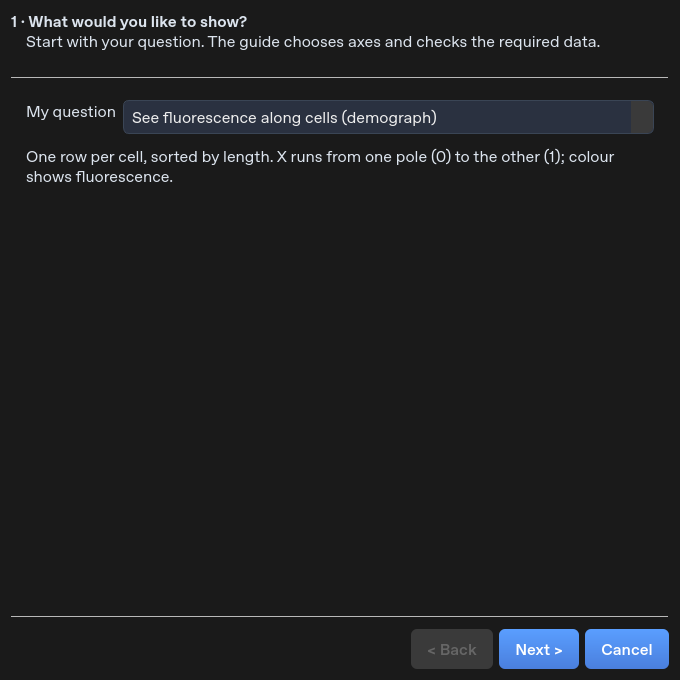
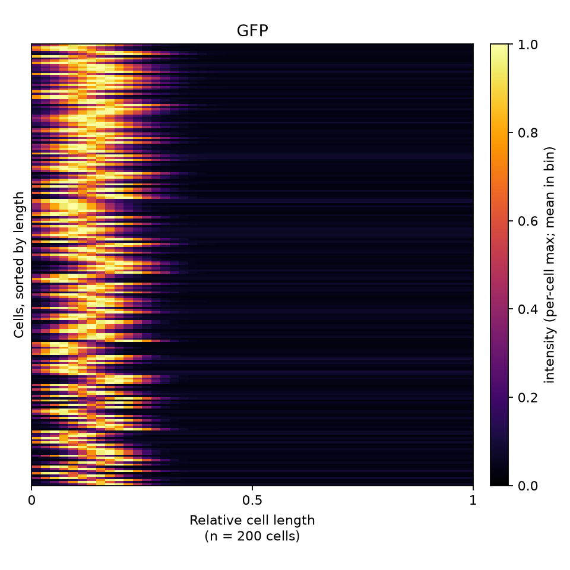
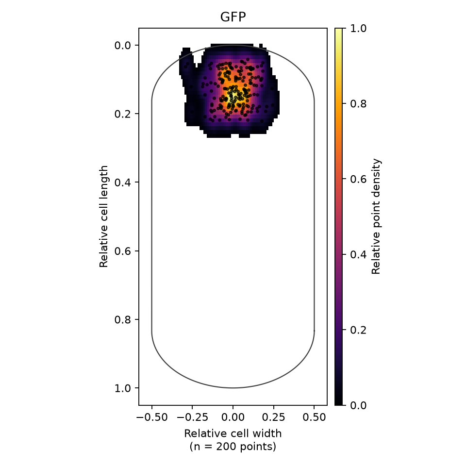

# Analysis figure guide

Analysis is in English. **Conditions & replicates…** stays at the top in both
simple and advanced modes. Existing `analysis_groups.json` files remain valid,
including tables with a legacy French replicate column.

Click **Figure guide…** and follow four steps:

1. **Question.** Compare a measurement, relate two measurements, draw a demograph,
   locate maxima, or count foci per cell.
2. **Population.** Choose a condition and frame. For spatial figures, choose a
   channel and either all matching XYs or one sample. Existing project masks and
   fluorescence images are matched automatically. Filtered masks are preferred.
   The review reports any unfiltered masks. Conditions can also be assigned here.
3. **Appearance.** Choose the relevant figure, normalization and pole alignment.
   Straight rods use the principal axis; curved rods can use the medial axis.
4. **Review and draw.** Read the selected population and choices, then draw.
   Spatial extraction runs in the background. Changing projects cannot inject
   the old calculation into the new project.

Calibration is read from mask/original-image metadata, then fluorescence image
metadata. If neither contains it, enter a fallback calibration in µm / px.
No file import dialog is used by this guide. Manual imports remain available in
**Advanced / MicrobeJ-style controls**. This is an alternative interface inspired
by MicrobeJ workflows, not the Fiji plugin itself.

## Demograph

One row is one cell observation, sorted by increasing cell length. The longitudinal
position is normalized from 0 to 1. Colour shows the mean fluorescence in each
longitudinal bin. Missing bins are not zero-filled. Per-cell maximum scaling is
recommended for localization patterns; raw intensity preserves brightness differences.
The displayed count is the number of cell observations, not the number of profile bins.
For films, **First frame** is the default; **All frames** repeats observations.

Geometric alignment does not identify pole age. Explicit brighter-pole alignment
places the brighter end at the left/top, based on mean fluorescence in the two
terminal quarters. This choice changes the population pattern and is recorded.

## Maxima map

Choose between:

- **Brightest pixel in each cell**: one raw-image intensity maximum per cell.
  Ties use the first pixel in row-major order. This does not detect foci.
- **Kept detected foci**: the saved filtered foci CSV for the chosen channel.
  Save Filtering results first. Foci outside the retained masks are excluded.

Coordinates are normalized separately for cell length (0–1) and width (−0.5–0.5).
Principal-axis foci coordinates retain subpixel projection; medial-axis positions
use the nearest measured mask pixel. Raw image x/y and cell metrics are exported.
The capsule is a schematic reference, not a fitted average cell. No measured
point is moved into or clipped to this outline. Relative coordinates are not µm.

The density is a 96 × 96 histogram with Gaussian smoothing (σ = 2 bins), scaled
to its peak (0–1).
Values below 1% of its peak are transparent. This scale is not a probability or
an intensity measurement. Individual point visibility can be toggled.

## Foci count

Select a **per-cell count** column (for example `num foci [GFP]`). The bars show
percentages within each condition and include cells with zero foci. A foci-only
table cannot supply cells with zero foci and must not be used as its denominator.

## Square publication output

Live canvases preserve a square shape when resizing. Figure exports use a 6 × 6
inch canvas: PNG is 1800 × 1800 at 300 dpi; PDF/SVG retain the square page. The
normalized-cell map has a taller plotting area inside this square canvas so the
reference cell is not stretched into a square.

Exports include source rows, plot data, an Excel workbook, metadata and Python,
R and MATLAB scripts. The scripts reproduce computed plot geometry; they do not
repeat segmentation. Python reproduction is exercised in tests. Native R/MATLAB
execution and native macOS display still require local validation.

Reopening the guide restores the previous successful figure choices in the
current session, including condition, frame, channel, normalization and title.

## Synthetic examples

These examples use simulated images and foci, not experimental results.

