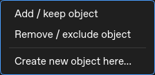

# Filtering: tables, selection and manual curation

Current custom branch: **BactoMate_Custom_New-Analyses**. Reviewed 4 November 2026.
[Settings](FILTERING_PRESETS.md) · [Batch/output review](FILTERING_REVIEW.md)

## Workspace and measurements

Open Filtering after segmentation/foci detection. **Mask / XY position** above
the tables chooses the image, labels, detections and curation to inspect.
Use the fixed **Cell table**, **Foci table**, **Cell filters** and **Foci filters**
pages instead of stacking every form and history above the image. Tables reserve
ten rows; their history selector/details stay below the rows. Import/Save presets
appear on the filter pages. A narrow/short viewport provides overflow without
squeezing fields or drawing history over table rows. Checkboxes/buttons wrap as
whole controls, and table sizing follows the actual font/header sizes.

The attached image sits beside these pages with an adjustable divider. Detaching
it gives the workspace the whole width; reattaching restores the image column.
LUTs and Keep/Exclude/Use filters commands follow the image. Detached LUTs remain
open on the right. Selecting a cell or focus in the image opens its matching table.
Changing View while editing filters keeps the current settings page open.

The cell table shows retained status, ID, area in µm², length/width in µm and
X/Y centers in pixels. Calibration changes update physical dimensions. Length
and width are major/minor axes of an equivalent ellipse, not skeleton length.
Invalid calibration does not yield fabricated physical values. Counts/history
refer to the current frame, not every frame of the film combined.

## Select the correct object type

In Cells mode, click a cell to select its row. In a foci-channel View, the target
becomes that channel's focus, not the cell containing it. Image and table selections
correspond; double-clicking a cell row centers the image. Click an empty background
to clear ordinary selection. Shift-click selects only explicitly clicked objects;
it does not select a continuous range of intermediate table rows.

A yellow highlight marks working selection. It is distinct from retained status:
only retained cells have a contour, white and thin by default, with a colour
picker. Rejected cells stay in the table for reintegration. Foci are green when
kept and red when rejected/excluded. Markers come from detections or explicit
manual annotations; unobserved foci are not invented for display.

## Reversible decisions

| Command | Result |
| --- | --- |
| Keep selected objects | Include despite automatic filter rejection |
| Exclude selected objects | Exclude despite automatic filter acceptance |
| Use filters for selected objects | Remove manual overrides and use the recipe |
| Delete/Backspace | Exclude the current active-type selection |

The image/table needs keyboard focus for Delete/Backspace. Commands are disabled
while processing. Excluding a focus does not exclude its host cell. Foci decisions
are channel-specific; decisions are also scoped by frame and source mask.
Apply current filters preserves the current View channel.

## Right-click and manual creation

Right-click opens a menu at the clicked coordinate. Opening it alone does not
keep an object. Add / keep object reintegrates an existing target, or starts
creation on background. Remove / exclude object excludes a target, or the selected
set if the target is already part of that set. Create new object here explicitly
starts annotation, including where automatic detection found nothing.

For foci, a new annotation is placed at the clicked point in the active foci
channel. For cells, the first point starts a polygon: click vertices, then Enter
or double-click to finish; Escape cancels only that drawing and keeps the detached
window open. The region must contain at least three pixels and cannot overlap
an existing cell. These are manual annotations, not automatic segmentation/spot
detection. They appear in tables and filtered exports; new foci carry `manual`
in the CSV. Original images and masks are not overwritten.

## Save and interpret history

The mask's `.curation.json` keeps decisions, manual geometry and local recipes.
Keep it with the mask. If source segmentation changes, old decisions are not
silently reused on unrelated labels. Histories record parameters, before/after
counts and changes, including per-channel foci counts where available. Viewing a
history step is not an undo operation. Recipes can be exported separately as
portable presets, but those presets do not carry object-specific selections.

Save with Filter File/Folder before relying on filtered objects in downstream
Analyze or kept-foci spatial figures. See the [batch guide](FILTERING_REVIEW.md).

## Rerun segmentation into the same folder

Filtering no longer stops with “Cannot restore mask state” when a mask TIFF has
been replaced. For a changed segmentation, it copies the old curation record to
`curation_archive/` beside the mask and starts fresh object choices/history.
Per-mask cell/foci filter parameters and calibration are retained. Original TIFFs
are not changed by this recovery, and old Keep/Exclude decisions or manual
geometry are never assigned to new cell IDs. Archives are records, not inputs
that Filtering automatically reapplies.

New curation records identify the label pixels independently of TIFF metadata,
compression and integer storage. Rewriting an identical label image keeps object
choices. Older records are upgraded when their original TIFF still matches; if
an older TIFF has already changed, the old curation is conservatively archived
because its former label geometry cannot be verified.

`.curation.json` is the expected persistent state file, not a second segmentation.
A name ending in `.curation.jsonXXXXXXXX.tmp` is a temporary atomic write.
Short Windows sharing locks are retried; a failed save keeps the last valid JSON
and removes its own scratch file. Opening a mask also cleans only its own exact
scratch names older than 24 hours, leaving recent and unrelated files untouched.
An already-open stale editor cannot overwrite curation for a replaced mask;
reopen Filtering to load that new segmentation.
