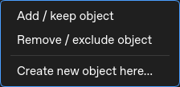

# Filtering : réglages par XY et curation à la souris

Ces changements concernent uniquement BactoMate_Custom_New-Analyses.

## LUT et filtres

Chaque canal et chaque masque gardent leur fenêtre de contraste. Passer de Phase
à GFP puis mCherry, y compris rapidement avant la fin du délai de rafraîchissement,
ne réinitialise pas les autres LUT. Un réglage volontairement sombre reste sombre.

**Exclude fully outside** est coché par défaut pour les nouveaux paramètres de
foci. Les anciens réglages explicitement enregistrés restent respectés.

Les filtres cellulaires, la calibration et les filtres de chaque canal de foci
sont indépendants pour chaque masque. Le premier passage sur un nouveau XY reprend
les réglages du masque précédent. Revenir sur un XY connu retrouve ses propres
valeurs. Elles sont enregistrées dans son fichier `.curation.json`, sans nouveau
fichier de paramètres de session par canal. Les exports portables de filtres
restent disponibles séparément avec **Save filter settings…**.

## Clic droit et sélection

Dans l’image détachée, clic gauche choisit un objet. Maj-clic ajoute uniquement
l’objet cliqué, sans sélectionner les lignes intermédiaires. Delete exclut les
objets sélectionnés du canal/type actif.

Le clic droit ouvre un menu au point cliqué ; il ne change aucune sélection
biologique tant qu’une action n’a pas été choisie :

- **Add / keep object** réintègre l’objet visé. Sur une zone sans objet, cette
  action lance une création.
- **Remove / exclude object** exclut l’objet visé. Si celui-ci appartient déjà à
  une sélection multiple, l’action porte sur cette sélection.
- **Create new object here…** permet de placer un nouveau focus dans le canal
  courant, même en l’absence de détection à cet endroit. En mode Cells, le point
  cliqué devient le premier point d’un contour : cliquer les sommets, puis Entrée
  ou double-clic pour terminer. Échap annule uniquement ce tracé. Un contour doit
  contenir au moins trois pixels et ne pas recouvrir une cellule existante.

Les créations sont des annotations manuelles ; elles ne constituent pas une
nouvelle détection automatique. Leur géométrie et leurs choix sont conservés dans
la curation. Les images et segmentations sources ne sont pas modifiées. Elles
apparaissent dans les tables et participent aux exports filtrés. Les nouveaux
foci portent le marqueur `manual` dans le CSV filtré.

## Filtrer un lot

Le sélecteur XY de prévisualisation et le dossier du lot sont séparés.
**Filter File/Folder** rouvre la liste de tous les masques disponibles, même
si l’image courante correspond à un seul fichier. Une indication montre si un
résultat filtré existe. Sélectionner les masques à exporter : chacun utilise sa
recette. Un nouveau masque reçoit les derniers réglages disponibles.

Les versions brute et filtrée du même masque sont regroupées dans cette liste.
Quand le masque source existe, Filtering repart de lui pour permettre la
réintégration d’objets précédemment exclus.

## Inspecter les fichiers produits

**File → Inspect generated files…** lance un audit en lecture seule du projet.
Le rapport distingue les rôles, recherche les contenus binaires identiques et
compare les CSV d’analyse aux feuilles correspondantes des classeurs XLSX.
Il peut être enregistré en JSON. Aucun résultat n’est supprimé.

Les versions brutes et filtrées sont nécessaires à la curation réversible. Un PNG
prévisualise une frame d’un TIFF ; ce n’est pas le même contenu qu’un film complet.
Les CSV d’analyse peuvent répéter les feuilles XLSX lorsque **Also save CSV** est
coché ; cette option reste décochée par défaut. Les classeurs de synthèse agrègent
volontairement les fichiers individuels. La génération répétée du même aperçu
PNG dans l’étape Filtering a été évitée.

Le menu de l’image détachée :

